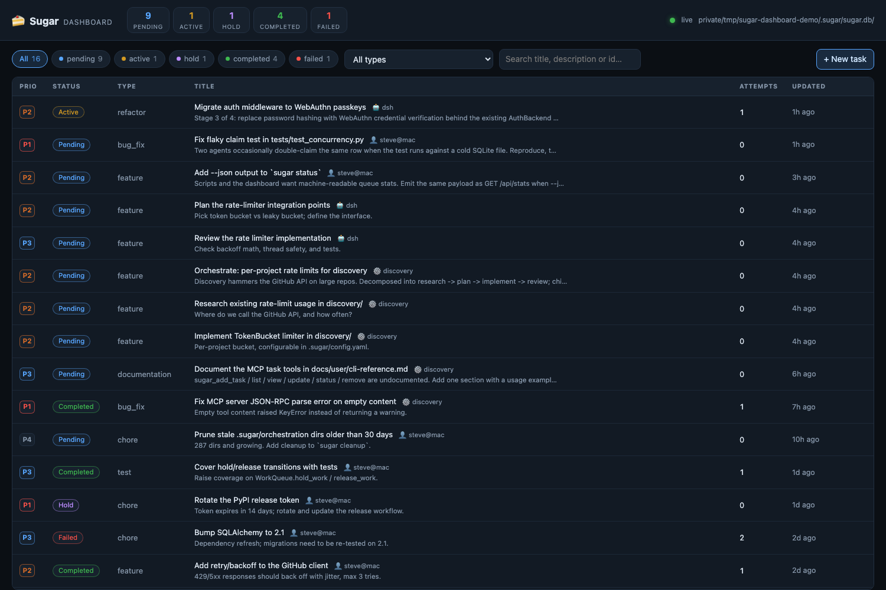
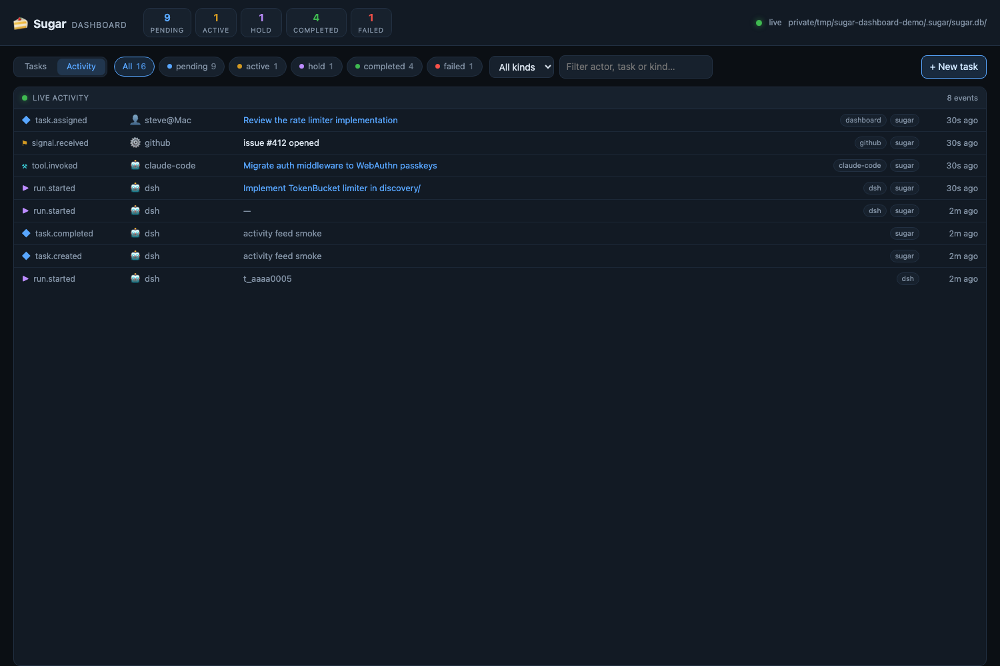
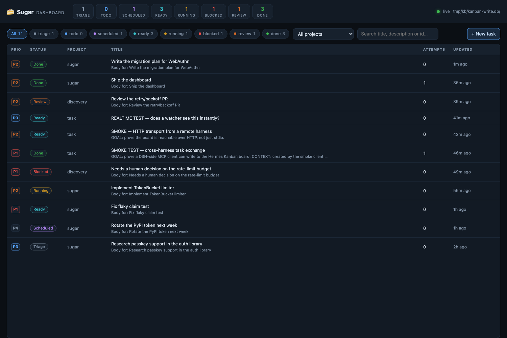

# Sugar

Persistent memory for AI coding agents.

<!-- mcp-name: io.github.cdnsteve/sugar -->

Your AI agent starts every session with amnesia. The architecture decisions, conventions,
and gotchas you explained last week are gone. Sugar is the local-first memory layer that
remembers them for you - per project, across projects, on your machine.

Your memory. Your machine. Your data.

## What Sugar Does

Sugar is a memory layer your AI coding agent can read and write directly:

- **Project memory** - Decisions, preferences, error patterns, and research stored per-project
- **Global memory** - Standards and guidelines shared across every project you work on
- **Semantic search** - Retrieve relevant context by meaning, not just keywords
- **MCP integration** - Your AI agent reads and writes memory directly during sessions
- **Local-first** - SQLite on your disk, no API keys, fully offline-capable
- **Task queue** - Optional autonomous execution, powered by the same memory layer

## Quick Start

```bash
# Install once, use in any project
pipx install sugarai

# Initialize in your project
cd ~/dev/my-app
sugar init

# Store what you know
sugar remember "We use async/await everywhere, never callbacks" --type preference
sugar remember "JWT tokens use RS256, expire in 15 min - see auth/tokens.py" --type decision
sugar remember "When tests fail with import errors, check __init__.py exports first" --type error_pattern

# Retrieve it later
sugar recall "authentication"
sugar recall "how do we handle async"
```

Your AI agent can also read and write memory directly - no copy-pasting required.

## MCP Integration

Connect Sugar's memory to your AI agent so it can access project context automatically.

**Claude Code - Memory server (primary):**
```bash
claude mcp add sugar -- sugar mcp memory
```

**Claude Code - Task server (optional):**
```bash
claude mcp add sugar-tasks -- sugar mcp tasks
```

Once connected, Claude can call `store_learning` to save context mid-session and `search_memories` to pull relevant knowledge before starting work. The memory server works from any directory - global memory is always available even outside a Sugar project.

**Other MCP clients (Goose, Claude Desktop):**
```bash
# Goose
goose configure
# Select "Add Extension" -> "Command-line Extension"
# Name: sugar
# Command: sugar mcp memory

# OpenCode - one command setup
sugar opencode setup
```

## Skills

Sugar ships Agent Skills - folders of instructions that teach coding agents to apply Sugar's methodology. Skills live under `skills/` and follow the [Agent Skills](https://agentskills.io) specification (a `SKILL.md` with name/description frontmatter plus instructions).

| Skill | What it does |
|-------|--------------|
| `sugar-memory` | Store and surface project context via Sugar's memory MCP server: recall context at task start, search before deciding, store learnings after completing work |
| `sugar-task-planner` | Turn a high-level task into a detailed execution plan: subtasks, dependencies, time estimates, risks, and measurable success criteria |
| `sugar-quality-guardian` | Review code across quality, testing, security, and performance, ending with a structured verdict |
| `sugar-orchestrator` | Coordinate multi-step workflows: analyze complexity, decompose tasks, assign roles, monitor execution |

Each skill includes an evaluation dataset (`evals/evals.json`) and is measured with [NVIDIA SkillEvaluator](https://github.com/NVIDIA/SkillEvaluator) against the OpenCode harness. See [Skill Benchmarks](docs/dev/skill-benchmarks.md) for the Skill Lift results - sugar-memory and sugar-task-planner both show measured positive lift.

## Global Memory

Some knowledge belongs to you, not just one project. Coding standards, preferred patterns, security practices - these should follow you everywhere.

```bash
# Store a guideline that applies to all your projects
sugar remember "Always validate and sanitize user input before any DB query" \
  --type guideline --global

sugar remember "Use conventional commits: feat/fix/chore/docs/test" \
  --type guideline --global

# View your global guidelines
sugar recall "security" --global
sugar memories --global

# Search works project-first, but guidelines always surface
sugar recall "database queries"
# Returns: project-specific memories + relevant global guidelines
```

Global memory lives at `~/.sugar/memory.db`. Project memory lives at `.sugar/memory.db`. When you search, project context wins - but `guideline` type memories from global always appear in results so your standards stay visible.

**Via MCP**, pass `scope: "global"` to `store_learning` to save cross-project knowledge directly from your AI session.

**Memory types:** `decision`, `preference`, `file_context`, `error_pattern`, `research`, `outcome`, `guideline`

Full docs: [Memory System Guide](docs/user/memory.md)

## How Memory Works

Sugar uses two SQLite databases and a tiered search strategy.

**Two stores:**
- **Project store** (`.sugar/memory.db`) - context specific to one project
- **Global store** (`~/.sugar/memory.db`) - knowledge that applies everywhere

**Seven memory types**, each with different retrieval behavior:

| Type | Purpose | TTL |
|------|---------|-----|
| `decision` | Architecture and implementation choices | Never |
| `preference` | How you like things done | Never |
| `file_context` | What files and modules do | Never |
| `error_pattern` | Bugs and their fixes | 90 days |
| `research` | API docs, library findings | 60 days |
| `outcome` | What worked, what didn't | 30 days |
| `guideline` | Cross-project standards and best practices | Never |

**Search strategy - project-first with reserved guideline slots:**

1. Search the project store first (local context always wins)
2. Reserve slots for global guidelines (cross-project standards always surface)
3. Fill remaining slots with other global results
4. Deduplicate across both stores

This means a mature project's local context dominates results. A new project with no local memory gets global knowledge automatically. And your guidelines are always visible regardless.

**Search engine:** Semantic search via sentence-transformers (all-MiniLM-L6-v2, 384-dim vectors) with sqlite-vec. Falls back to SQLite FTS5 keyword search, then LIKE queries. No external API calls - everything runs locally.

```bash
# Install with semantic search (recommended)
pipx install 'sugarai[memory]'

# Works without it too - just uses keyword matching
pipx install sugarai
```

**MCP tools available to your AI agent:**

| Tool | What it does |
|------|-------------|
| `search_memory` | Search both stores, returns results with scope labels |
| `store_learning` | Save a memory (pass `scope: "global"` for cross-project) |
| `recall` | Get formatted markdown context for a topic |
| `get_project_context` | Full project summary including global guidelines |
| `list_recent_memories` | Browse recent memories by type |

**MCP resources:**
- `sugar://project/context` - project summary
- `sugar://preferences` - coding preferences
- `sugar://global/guidelines` - cross-project standards

## Task Queue

The task queue lets you hand off work and let it run autonomously. It reads from the same memory store, so Sugar already knows your preferences and patterns before it starts.

```bash
# Add tasks
sugar add "Fix authentication timeout" --type bug_fix --urgent
sugar add "Add user profile settings" --type feature

# Start the autonomous loop
sugar run
```

Sugar picks up tasks, executes them with your configured AI agent, runs tests, commits working code, and moves to the next task. It runs until the queue is empty or you stop it.

**Delegate from Claude Code mid-session:**
```
/sugar-task "Fix login timeout" --type bug_fix --urgent
```

**Advanced task options:**
New in 3.10: Task Orchestration decomposes large features into a 4-stage workflow (research, plan, implement, review) with specialist agent routing and dependency-ordered sub-tasks.
```bash
# Orchestrated execution - 4-stage workflow (New in 3.10)
sugar add "Add OAuth authentication" --type feature --orchestrate

# Iterative mode - loops until tests pass
sugar add "Implement rate limiting" --ralph --max-iterations 10

# Check queue status
sugar list
sugar status
```

Full docs: [Task Orchestration](docs/task_orchestration.md)

## Mission Control: see, trust and steer your agents

Sugar already coordinates work. Mission Control is the missing layer for a human and
a fleet of agents: one local, real-time picture of **what is being worked on, by
which agent or harness, for what task, and what just happened** — plus the controls to
steer it. No cloud, no account; everything stays in two SQLite files on your disk.

- **See it live.** A web UI and a native macOS app, both fed by the same REST + SSE API.
  Tasks added by `sugar add`, the MCP server, `sugar run`, or another harness appear in
  under a second.
- **Know who did it.** Every task carries `created_by` (human/agent/system) and every
  claim records `claimed_by` + a lease; every event records actor, harness, machine and
  task. Claims are atomic, so two harnesses cannot double-work the same task.
- **Steer it.** Create, edit, claim, complete, hold/block, release and reassign from the
  UI or the menu bar — the same verbs the agents use.
- **Audit it.** An append-only event spine records every transition, so "what did the
  fleet do yesterday, and who is holding this now?" is a query, not a guess.
- **Bring your own board.** Serve Sugar's queue, or point the same UI at a shared Hermes
  Kanban board; writes still go through that board's own command surface.

```bash
pip install 'sugarai[dashboard]'   # starlette + uvicorn
sugar dashboard --open             # Sugar queue  -> http://127.0.0.1:7331
sugar dashboard --board kanban     # shared board -> same UI, reads kanban.db
```



- Live updates over Server-Sent Events, so tasks added by `sugar add`, the MCP server,
  `sugar run`, or another process appear in under a second — no refresh.
- Create, edit, hold, release and delete tasks from the browser UI.
- Same REST + SSE API for everything (`GET /api/tasks`, `PATCH /api/tasks/{id}`,
  `GET /api/events`, …), so it is scriptable and safe to point other tools at.
- `--read-only` exposes the queue without allowing writes; `--db` / `--port` override
  the defaults. The server never leaves `127.0.0.1`.

**Watch the nervous system.** An optional event spine (`~/.sugar/events.db`) records every
task transition plus harness telemetry, streamed live over SSE and rendered as an Activity feed:



- observers tail the Hermes Kanban `task_events` log and Sugar's own queue — no missing history;
- harnesses can POST their own signals to `/api/events` (`run.started`, `tool.invoked`, `signal.*`);
- every row carries actor + kind, harness, machine, project and a link back to the task.

**Point it at a shared board.** The same UI can serve a Hermes Kanban board
(`sugar dashboard --board kanban`): reads come from `kanban.db`, every write goes
through `hermes kanban`, so claims, dependencies and review gates keep their single
implementation. Columns, counts and available actions come from `GET /api/meta`.



**Native macOS app.** Prefer a real window? `apps/macos/` contains SugarDash, a
dependency-free SwiftUI app (task list, filters, detail, add/edit/delete, menu bar
pending count, live SSE):

```bash
cd apps/macos && ./build-app.sh && open dist/SugarDash.app
```

Try it with a seeded demo queue (never touches your real `.sugar/`):

```bash
python scripts/demo_dashboard.py --serve --open
```

Full docs: **[Mission Control](docs/mission-control.md)** ·
[Local Dashboard API](docs/local-dashboard.md) ·
[Agent teams analysis](docs/agent-teams.md)

## Autonomous Issue Resolution (optional)

Because Sugar remembers your codebase and conventions, it can also resolve routine issues
autonomously. Point it at a GitHub repo, configure which labels to act on
(`security`, `bug`, `dependabot`), and Sugar will read each issue, implement the fix, run your
tests, and open a PR.

```
Labeled issue appears on GitHub
  -> Sugar picks it up (label filter: "security", "dependabot", "bug")
  -> AI agent reads the issue, analyzes the affected code
  -> Fix implemented, tests run locally
  -> PR opened - you review and merge
```

This is one application of the memory layer, not the headline. Use Sugar purely as memory,
or enable resolution - your choice. See [workflow examples](docs/workflows/) for security
auto-fix, bug triage, test coverage, and more.

## Supported AI Tools

Works with any CLI-based AI coding agent:

| Agent | Memory MCP | Task MCP | Notes |
|-------|-----------|---------|-------|
| [Claude Code](https://docs.anthropic.com/en/docs/claude-code) | Yes | Yes | Full support |
| [OpenCode](https://github.com/opencode-ai/opencode) | Yes | Yes | `sugar opencode setup` |
| [Goose](https://block.github.io/goose) | Yes | Yes | Via MCP |
| [Aider](https://aider.chat) | Via CLI | Via CLI | Manual recall |

## Installation

**Recommended: pipx** - installs once, available everywhere, no venv conflicts:
```bash
pipx install sugarai
```

**Upgrade / Uninstall:**
```bash
pipx upgrade sugarai
pipx uninstall sugarai
```

<details>
<summary>Other installation methods</summary>

**pip** (requires venv activation each session)
```bash
pip install sugarai
```

**uv**
```bash
uv pip install sugarai
```

**With semantic search (recommended for memory):**
```bash
pipx install 'sugarai[memory]'
```

**With GitHub integration:**
```bash
pipx install 'sugarai[github]'
```

**All features:**
```bash
pipx install 'sugarai[all]'
```

</details>

Sugar is **project-local** by default. Each project gets its own `.sugar/` folder with its own database and config. Global memory lives at `~/.sugar/`. Like `git` - one installation, per-project state.

## Project Structure

```
~/.sugar/
└── memory.db          # Global memory (guidelines, cross-project knowledge)

~/dev/my-app/
├── .sugar/
│   ├── sugar.db       # Project memory + task queue
│   ├── config.yaml    # Project settings
│   └── prompts/       # Custom agent prompts
└── src/
```

**Recommended .gitignore:**
```gitignore
.sugar/sugar.db
.sugar/sugar.log
.sugar/*.db-*
```

Commit `.sugar/config.yaml` and `.sugar/prompts/` to share settings with your team.

## Configuration

`.sugar/config.yaml` is created on `sugar init`:

```yaml
sugar:
  dry_run: false
  loop_interval: 300
  max_concurrent_work: 3

claude:
  enable_agents: true

discovery:
  github:
    enabled: true
    repo: "user/repository"
```

## Documentation

- [Quick Start](docs/user/quick-start.md)
- [Memory System](docs/user/memory.md)
- [Skill Benchmarks](docs/dev/skill-benchmarks.md)
- [CLI Reference](docs/user/cli-reference.md)
- [Task Orchestration](docs/task_orchestration.md)
- [Goose Integration](docs/user/goose.md)
- [OpenCode Integration](docs/user/opencode.md)
- [GitHub Integration](docs/user/github-integration.md)
- [Configuration Guide](docs/user/configuration-best-practices.md)
- [Troubleshooting](docs/user/troubleshooting.md)

## Requirements

- Python 3.11+
- A CLI-based AI agent: [Claude Code](https://docs.anthropic.com/en/docs/claude-code), [OpenCode](https://github.com/opencode-ai/opencode), [Aider](https://aider.chat), or similar

## Contributing

Contributions welcome. See [CONTRIBUTING.md](docs/dev/contributing.md).

```bash
git clone https://github.com/roboticforce/sugar.git
cd sugar
uv pip install -e ".[dev,test,github,mcp]"
pytest tests/ -v
```

## License

**Dual License: AGPL-3.0 + Commercial**

- **Open Source (AGPL-3.0)**: Free for open source and personal use
- **Commercial License**: For proprietary use - [sugar.roboticforce.io/licensing](https://sugar.roboticforce.io/licensing)

---

> Sugar is provided "AS IS" without warranty. Review all AI-generated code before use.
