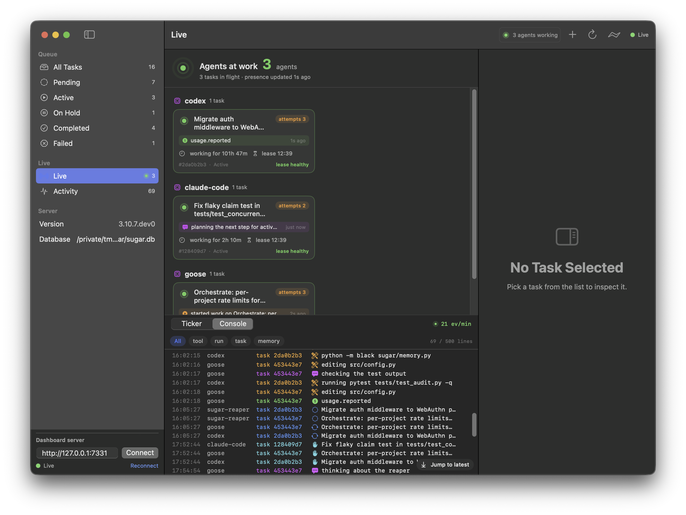
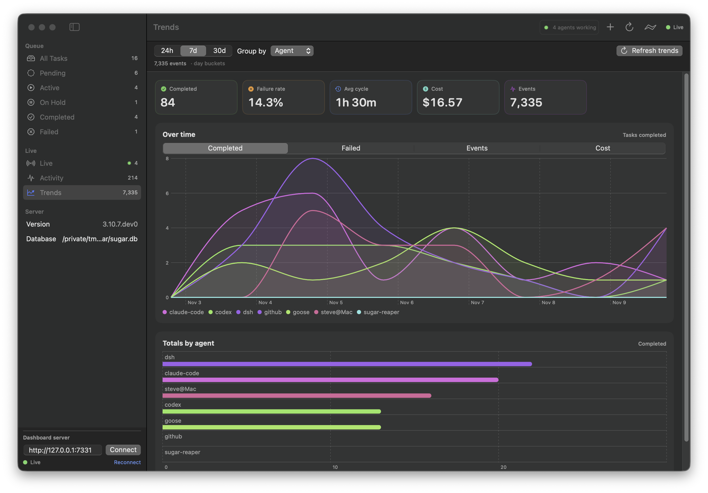

<div align="center">

# Sugar

**The coordination and evidence layer for your agent fleet.**

One durable board for Claude Code, Codex, Cursor, Goose, OpenCode, DSH — and any harness that can claim a task.
Atomic claims, live agent activity, cost attribution and tamper-evident history. Local-first, no account.

<!-- mcp-name: io.github.cdnsteve/sugar -->

[](https://pypi.org/project/sugarai/)
[](pyproject.toml)
[](https://github.com/roboticforce/sugar/actions/workflows/ci.yml)
[](LICENSE)
[](docs/local-dashboard.md)

[Quick start](#quick-start) · [See it work](#see-your-fleet-work) · [Why Sugar](#why-sugar) · [Works with](#works-with-your-harnesses) · [Docs](docs/README.md) · [Team edition](#team-edition-self-hosted)



</div>

## Your agents can't see each other

You run four agents across three harnesses on one repo. Then:

- Two agents pick up the same task and overwrite each other's work.
- A crashed run keeps a task "claimed" forever; the queue quietly stalls.
- "What happened yesterday?" lives in six terminal tabs and a scrollback buffer.
- You can't answer *who did what, with which harness, for which task — and what did it cost?*
- Your agent starts every session with amnesia: last week's decisions, conventions and dead ends are gone.

A prettier kanban board doesn't fix this. The missing layer is underneath: a **durable queue**, **atomic claims and leases**, **provenance for every actor**, and a **history you can replay and export**. That's what Sugar is.

## One board. Any harness. Full history.

Sugar is local-first infrastructure for a fleet of coding agents. Every harness gets the same durable work
queue and the same memory. Every claim, transition and tool call lands in an append-only event spine. You watch
the fleet in a web dashboard or a native macOS app — on your machine, in your files, with no account.

Your agents keep their own subscriptions and workflows. Sugar doesn't replace Claude Code or Codex; it sits
between them and your repo.

### Coordinate — a queue agents can't double-claim

- Durable SQLite queue with priorities, dependencies, attempts, hold/release and retries.
- **Atomic claim + lease + heartbeat.** If a worker dies, the lease expires and a reaper requeues the task.
- The same verbs from the CLI (`sugar add`, `sugar list`, `sugar run`), MCP tools, REST API and dashboard.
- Keep your existing board: serve Sugar's queue, or mirror a Hermes Kanban board with `--board kanban`
  (Sugar reads it; Hermes keeps its write path).

### See — Mission Control for the fleet

- Web dashboard and native macOS app, both on the same REST + SSE contract.
- **Live floor:** every working agent with its current action, elapsed/lease countdowns and lease health.
- **Streaming console:** tool calls, run starts/ends and usage events as they happen.
- **Trends:** throughput, failures, cycle time and reported spend over time, by agent, harness or project.
- Activity feed, search, filters and direct task links across all of it.



### Prove — history with receipts

- **Append-only event spine** (`~/.sugar/events.db`, retention configurable) records every task transition and
  every harness event: actor, harness, machine, session, task, project, run and trace id.
- **Usage and cost attribution** (`sugar usage`, `/api/usage`): tokens and cost as your harness reports them —
  no invented pricing table.
- **Tamper-evident audit exports** (`sugar audit export` / `sugar audit verify`): canonical JSONL plus a
  SHA-256 manifest and optional HMAC signature. Export before retention prunes, keep the evidence.
- Claims are recorded in the same transaction as the work item, so "who is holding this task?" is a query,
  not a guess.

### Connect — one board, many harnesses

- **MCP servers** for tasks and memory: Claude Code, Codex, Cursor, Goose, OpenCode and any MCP client can
  read context, claim work and complete it.
- **REST + SSE** for custom scripts, bots and CI.
- **CLI** for everything a human needs, including `sugar emit` for harnesses that stream their own telemetry.
- **TaskStore port + conformance suite**: SQLite today; the contract is backend-agnostic.

### Remember — your context, not the vendor's

- Project memory (`.sugar/memory.db`) and global memory (`~/.sugar/memory.db`), with seven memory types:
  decisions, preferences, file context, error patterns, research, outcomes and guidelines.
- Semantic search via local embeddings (`sugarai[memory]`), with FTS5 keyword fallback. No external API calls.
- Agents read and write memory directly through MCP: `search_memory`, `store_learning`, `recall`,
  `get_project_context`, `list_recent_memories`.

## Quick start

```bash
# Install once, use in any project
pipx install 'sugarai[all]'

cd ~/dev/my-app
sugar init

# Give the fleet work
sugar add "Fix the auth timeout" --type bug_fix --urgent
sugar add "Add profile settings" --type feature

# Watch it, or let Sugar run it
sugar dashboard --open
sugar run
```

Your agent gets memory and the board over MCP:

```bash
claude mcp add sugar       -- sugar mcp memory
claude mcp add sugar-tasks -- sugar mcp tasks
```

```bash
# Other clients
sugar opencode setup     # OpenCode, one command
goose configure          # Goose: Add Extension -> Command-line -> sugar mcp memory
```

## See your fleet work

The dashboard and app are only half the story — the Live view is the part that makes a fleet feel real.
Harnesses stream their tool calls with one line each:

```bash
sugar emit --kind tool.invoked --task-id "$TASK_ID" \
  --message "running pytest tests/test_api.py" --payload file=src/api.py
```

No harness wired up yet? The repo ships a simulator for demos:

```bash
git clone https://github.com/roboticforce/sugar.git && cd sugar
python scripts/demo_dashboard.py --serve --open      # demo queue + dashboard
python scripts/simulate_agent_activity.py            # live agents in a second shell
```

Trends need history; seed a throwaway spine and open the Trends view:

```bash
python scripts/seed_demo_trends.py --db /tmp/sugar-dashboard-demo/.sugar/events.db --reset
```

Full walkthrough: [Mission Control](docs/mission-control.md) · [Telemetry](docs/telemetry.md) · [Trends](docs/trends.md)

## Works with your harnesses

Any harness that can run a CLI or speak MCP can use the board and the memory. The built-in runner
(`sugar run`) drives Claude Code through the Agent SDK today; the other harnesses keep doing their own thing
while Sugar coordinates them.

| Harness | Board (MCP / CLI / REST) | Shared memory | Notes |
|---|---|---|---|
| [Claude Code](https://docs.anthropic.com/en/docs/claude-code) | Yes | Yes | Built-in runner; plugin + Skills; full support |
| Codex | Yes | Yes | Via MCP/CLI; no runner coupling |
| Cursor | Yes | Yes | Via MCP |
| [Goose](https://block.github.io/goose) | Yes | Yes | Via MCP extension |
| [OpenCode](https://github.com/opencode-ai/opencode) | Yes | Yes | `sugar opencode setup` |
| [Aider](https://aider.chat) | Yes | Yes | Via CLI/MCP |
| Hermes Kanban | Yes | — | Mirror a board with `--board kanban`; Hermes owns writes |
| Custom scripts / bots | Yes | Yes | REST + SSE, or MCP |

## Team edition (self-hosted)

The default dashboard binds loopback and needs no auth. For a team, run one board on a shared machine with
scoped tokens — reads and writes, nothing in a vendor cloud:

```bash
cat ~/.sugar/board-tokens        # name:scope:secret (scope: read | write; file must be 0600)
sugar dashboard --bind 0.0.0.0 --allow-remote --token-file ~/.sugar/board-tokens
```

The browser exchanges a one-time token for a `SameSite=Strict` cookie; API/SSE accept `Authorization: Bearer`.
Remote binds are refused without both `--allow-remote` and a token source, the foreign-Origin write guard
stays on, and TLS is expected from a reverse proxy. See [Board Server](docs/board-server.md) for the threat
model and Caddy/nginx setup.

What teams get today: one live board, provenance, cost attribution, and audit exports. Approval policies,
RBAC/SSO, quotas and a hosted relay are on the roadmap — [tell us what your team needs](mailto:contact@roboticforce.io?subject=Sugar%20team%20edition).

## Why Sugar

- **Harness-neutral by design.** You don't have to pick a winner. Claude Code, Codex, Cursor, Goose, OpenCode,
  DSH and your own scripts share one queue and one history.
- **Local-first, not cloud-first.** Task state, memory and the event spine are SQLite files on your disk. No
  account, no repo upload, no vendor in the loop. Remote mode is opt-in and self-hosted.
- **Evidence beats dashboards.** Any tool can show you a board. Sugar records the claim, the lease, the actor,
  the harness, the transitions and the spend — then lets you export and verify it.
- **Durable, not demo-grade.** Atomic claims, lease heartbeats, crash reaping, dependency gating and retries are
  tested against a backend-agnostic conformance suite.
- **Open and inspectable.** Dual-licensed AGPL-3.0 + commercial; the REST/SSE contract, event schema and
  adapter playbook are documented and versioned.

**What Sugar is not:** not a model vendor, not an agent runtime or cloud coding agent, not a code host, and not
another kanban UI. It's the neutral layer underneath the harnesses you already chose.

<details>
<summary><strong>FAQ</strong></summary>

**Is this just a kanban board for agents?**
No. A board shows status; Sugar owns the queue, the claim/lease transaction, dependency gating, provenance and
an append-only history. It can mirror a Hermes Kanban board, but it doesn't depend on one.

**How is this different from Claude Code Agent Teams or a single-harness orchestrator?**
Those make one harness better at running its own agents. Sugar coordinates *across* harnesses and keeps the
durable record. You can run Claude Code Agent Teams and still put their work on the same board as Codex.

**Does Sugar send my code or data anywhere?**
No. State is local SQLite by default; the dashboard binds loopback. Telemetry is what your harness explicitly
emits (`sugar emit` / `POST /api/events`), and audit exports are files you write yourself.

**Do I need to change how my agents work?**
No. Add the MCP servers (tasks + memory) or use the CLI/REST API. The built-in runner is optional.

**Is it production-ready?**
The 3.10 line is an early release: used daily, with a large test suite and CI across Linux/macOS/Windows, but
expect rough edges. Start with a demo board or a side project, then move your real queue over.

</details>

## Install

**Recommended: pipx** — one install, available everywhere:

```bash
pipx install 'sugarai[all]'          # dashboard, memory search, MCP, GitHub, OpenCode
pipx upgrade sugarai
```

<details>
<summary>Other options</summary>

```bash
pip install 'sugarai[all]'           # inside a venv
uv pip install 'sugarai[all]'        # uv
pipx install sugarai                 # core only (keyword memory, no dashboard)
pipx install 'sugarai[dashboard]'    # web dashboard + macOS app backend
pipx install 'sugarai[memory]'       # semantic memory (local embeddings)
```

**Native macOS app:** [latest release](https://github.com/roboticforce/sugar/releases/latest) — or build it:

```bash
cd apps/macos && ./build-app.sh && open dist/SugarDash.app
```

**Requirements:** Python 3.11+, macOS 14+ for the app, and a CLI/MCP-capable coding agent if you want agents to
claim work.

</details>

## Also in the box

- **Discovery** — turn GitHub issues, error logs and code analysis into queue items.
- **Autonomous runner** — `sugar run` claims, executes, tests, commits and moves on; `--ralph` iterates until
  tests pass.
- **Orchestration** — decompose a large task into a research → plan → implement → review workflow.
- **Quality gates and hooks** — pre/post-execution checks, file protection and command guardrails.
- **Agent Skills** — `sugar-memory`, `sugar-task-planner`, `sugar-quality-guardian`, `sugar-orchestrator`,
  with evaluation data in `skills/`.
- **Claude Code plugin** — slash commands and hooks via `.claude-plugin/`.
- **Task types, learning and memory types** — the boring machinery that makes repeated runs better.

## Documentation

- [Mission Control](docs/mission-control.md) — dashboard, macOS app, event spine
- [Local Dashboard API](docs/local-dashboard.md) — frozen REST/SSE contract
- [Trends](docs/trends.md) · [Telemetry](docs/telemetry.md) · [Usage & cost](docs/usage.md) · [Audit exports](docs/audit.md)
- [Board Server](docs/board-server.md) — team/remote access and TLS
- [Storage Port](docs/storage-port.md) · [Adapters](docs/adapters.md) — backends and harness playbook
- [Memory System](docs/user/memory.md) · [CLI Reference](docs/user/cli-reference.md) · [Quick Start](docs/user/quick-start.md)
- [Agent Teams: market & validation](docs/agent-teams-market.md) · [Business strategy](docs/business-strategy.md)

## Status and roadmap

Sugar is an early 3.10 release. The stable parts: the task store contract, the event spine schema, the REST/SSE
contract and the audit format. The moving parts: live telemetry wiring, remote/mobile access, approval policies
and additional runners.

Next up, roughly in order: zero-config harness hooks (so Live lights up without manual `sugar emit`), pairing and
a mobile-friendly Mission Control, permission modes with ledger-recorded approvals, then a Postgres backend.
Ideas and bug reports are welcome — [open an issue](https://github.com/roboticforce/sugar/issues).

## Contributing

```bash
git clone https://github.com/roboticforce/sugar.git
cd sugar && git checkout develop
uv pip install -e ".[dev,test,github,mcp]"
pytest tests/ -v
```

See [CONTRIBUTING](docs/dev/contributing.md). PRs target `develop`; releases go to `main`.

## License

**Dual license: AGPL-3.0 + commercial.**

- **AGPL-3.0** — free for open source and personal use.
- **Commercial license** — for proprietary use. [Contact RoboticForce](mailto:contact@roboticforce.io) or see
  [LICENSE](LICENSE).

---

> Sugar is provided "AS IS" without warranty. Review all AI-generated code before use.
