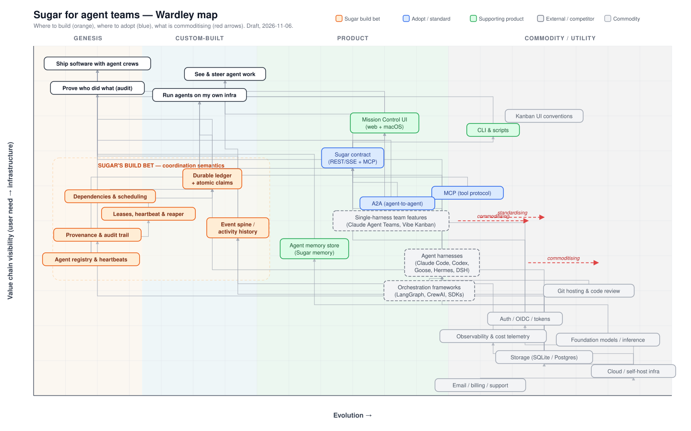
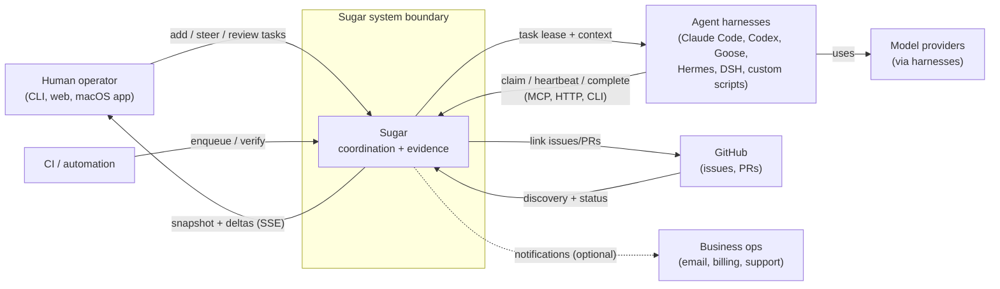
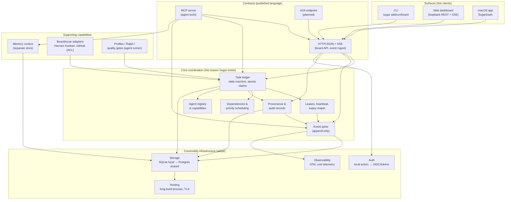
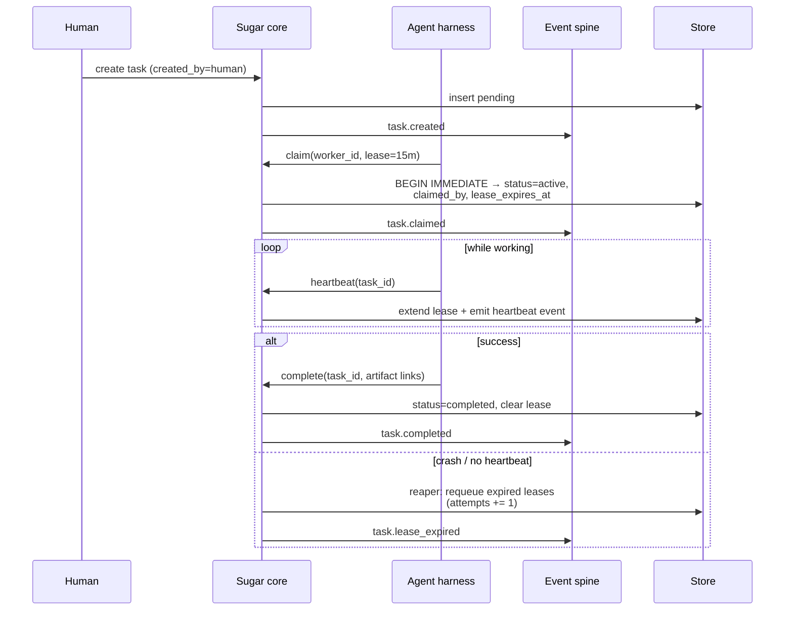
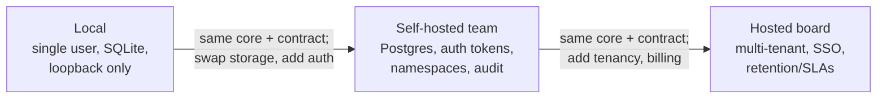
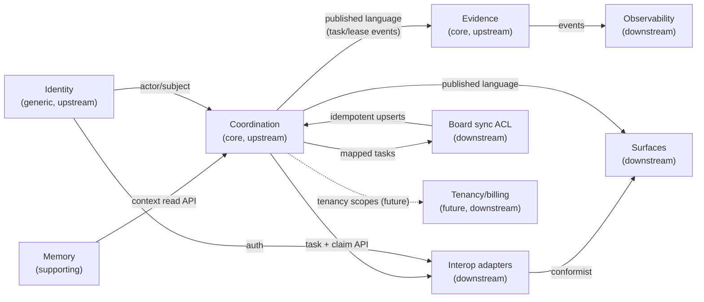

# Agent teams: architecture and business-domain boundaries

*Companion to [agent-teams-market.md](agent-teams-market.md) (market, positioning, validation) and
[agent-teams.md](agent-teams.md) (Sugar's current capabilities). This document fixes the architecture, the
domain boundaries, and — via the Wardley map — where to build versus where to buy/adopt.*

*Generated by `scripts/wardley_agent_teams.py` (PNG: `docs/images/wardley-agent-teams.png`). Arrows point from a
component to the capability it enables; dashed red arrows mark capabilities that are commoditising.*

---

## 1. The one-line boundary

> **Sugar is a coordination and evidence system. It is not an agent vendor, a model vendor, a code host, or an
> identity provider.**

Everything below follows from that sentence: Sugar owns the *ledger* (what work exists, who may claim it, what
happened), exposes neutral *contracts* so any agent/harness can participate, and treats storage, hosting, auth,
models, code hosting and billing as commodity inputs.

---

## 2. System architecture

### 2.1 Context (who talks to Sugar, and about what)

**External by design:** harnesses, models, GitHub, CI. Sugar never owns the agent loop, the model calls, or the
repository; it records and coordinates around them.

### 2.2 Containers (inside the boundary)

Hard rules (see §4): surfaces and adapters never write the store directly; every mutation goes through the core
API; the event spine is append-only; storage is swappable behind the core.

### 2.3 Task lifecycle (runtime view)

### 2.4 Deployment evolution (only infrastructure moves)

The core semantics (claims, leases, dependencies, provenance, events) and the published contract must be
**identical** at every deployment; only infrastructure adapters change. That is the architectural test for "can
we go to cloud without a rewrite?" — yes, if no feature is allowed to depend on SQLite or on loopback.

---

## 3. The Wardley map: where to build, adopt and buy

### 3.1 How to read it

- **Y axis — value chain visibility**: top is the user need; bottom is utility infrastructure.
- **X axis — evolution**: genesis → custom-built → product → commodity/utility.
- Node colour: **orange = Sugar build bet**, blue = adopt/standardise, green = supporting product, grey =
  external/competitor or commodity.
- Dashed red arrows are movement: capabilities sliding right (commoditising/standardising).

### 3.2 What the map says

**Sugar's build bets sit on the left (genesis/custom-built)** — these are the only things worth differentiating
on:

| Build bet | Why it cannot be bought | Failure if absent |
|---|---|---|
| Durable ledger + atomic claims | Every vendor's board is UI-first; transactional claim semantics are ours | Two agents do the same task; work silently lost |
| Leases, heartbeat, reaper | Requires ownership of the task lifecycle | Crashed agents strand work; board lies about in-flight work |
| Dependencies & scheduling | Needs a real state machine, not labels | Dependents start early; "parallel" becomes rework |
| Provenance & audit trail | Vendor-neutral, append-only, exportable | Can't answer "who did what, with what harness, on whose instruction" |
| Agent registry & heartbeats | Capability routing across heterogeneous harnesses | No way to say "this agent only takes frontend work" |
| Event spine | Append-only history feeding UI, audits, OTel | No history to analyse, bill or investigate |

**Adopt, don't invent (blue):**
- **MCP** — already implemented; the tool-side standard.
- **A2A** — the agent-to-agent standard is moving right fast ([150+ orgs, production use](https://www.linuxfoundation.org/press/a2a-protocol-surpasses-150-organizations-lands-in-major-cloud-platforms-and-sees-enterprise-production-use-in-first-year)); shipping an A2A-compatible endpoint is distribution, not differentiation.
- **REST/JSON + SSE** — commodity; keep it boring and versioned.
- **Kanban UI conventions** — commodity; don't build a UI moat around them.

**Commodity — buy/adopt and never build (grey):** storage (SQLite/Postgres), hosting, auth/OIDC, observability
& cost telemetry (OTel), email/billing/support, foundation models, git hosting and code review. Using them is not
a strategy; *not* building them is.

**Commoditising (red arrows) — the danger zone:**
- **Single-harness team features** (Claude Code Agent Teams, Vibe Kanban): free/experimental or free-plus-cloud;
  they will own the "spawn and watch sessions" experience.
- **Agent harnesses themselves**: increasingly interchangeable, which is *good* for Sugar's cross-harness story.
- **A2A**: standardising means we should adopt it early and cheaply, not build a proprietary protocol.

### 3.3 Strategic plays

1. **Build left, buy right.** Invest engineering in the orange box (coordination correctness + provenance);
   adopt everything to the right with thin adapters.
2. **Own the published language.** The Sugar contract is the asset: versioned, documented, multi-protocol
   (MCP/HTTP/A2A), with a conformance suite. Ecosystem adapters should be cheap to write, not bespoke.
3. **Keep storage pluggable.** The local→team→cloud ladder is only credible if the core never imports SQLite
   specifics into business rules.
4. **Don't fight the UI war.** Ship a good-enough board; spend effort on durability, audit and correctness that
   screenshot-first competitors don't show.
5. **Commoditise the agent runner.** Profiles/Ralph/quality gates are valuable for Sugar users, but for teams the
   *external harnesses* are first-class; Sugar must not require its own runner.
6. **Use protocols as distribution.** Every adapter (Hermes, DSH, Goose, Claude Code plugin, A2A) is a
   distribution channel into someone else's workflow.

---

## 4. Business-domain boundaries (DDD)

### 4.1 Bounded contexts

| Context | Type | Owns | Must not |
|---|---|---|---|
| **Coordination** (ledger, leases, dependencies, registry) | **Core** | Task state machine, claim/lease invariants, scheduling, agent identity/registration | Know about UI, MCP, SQLite, HTTP |
| **Evidence** (provenance, event spine) | **Core** | Append-only event log, provenance records, audit exports | Be writable/amendable by consumers; contain secrets |
| **Memory** | Supporting (core-adjacent) | Cross-session memory store, retrieval | Become the source of task truth |
| **Surfaces** (CLI, web, macOS) | Supporting | Presentation, commands, local UX | Talk to the store directly; contain business rules |
| **Interop adapters** (MCP, HTTP, A2A, webhooks) | Supporting | Translation, auth scoping, versioning | Encode coordination rules |
| **Board sync** (Hermes Kanban, GitHub issues) | Supporting (ACL) | Idempotent mapping of external tasks/statuses | Become a second task store for Sugar semantics |
| **Identity** | Generic (adopt) | Actor identity, tokens, OIDC (future) | Invent its own directory/auth protocol |
| **Observability & cost** | Generic/supporting | OTel export, metrics, cost accounting | Be required for core operation |
| **Tenancy, billing, entitlements** | Supporting (future, cloud only) | Plans, quotas, invoices | Exist in local mode |
| **Agent execution** (profiles, Ralph, quality gates) | Supporting (adjacent product) | Running agents, gates, iterations | Be required by the coordination core |

### 4.2 Context map

Integration patterns, deliberately chosen:

- **Published language** for the core contract (versioned JSON schema + SSE/event types).
- **Anti-corruption layer** for Hermes Kanban and GitHub: external models never leak into the core state machine.
- **Conformist** surfaces: the CLI/web/macOS app must bend to the contract, never the reverse.
- **Separate ways** for memory: it has its own store and is not on the task-critical path.
- **Identity upstream (generic)**: local actor strings today; OIDC/tokens when team mode arrives.

### 4.3 Invariants (the rules that make the boundaries real)

1. **Single writer per task**: a task is claimed exactly once; claims/leases are transactional.
2. **Append-only evidence**: events are never mutated or deleted by consumers (retention pruning is a policy job
   with an audit record).
3. **Surfaces are dumb**: no UI feature may require a new database query path; it goes through the contract.
4. **Adapters translate, never decide**: MCP/A2A/HTTP map arguments to core commands.
5. **Board sync is idempotent**: replaying the same external event must not duplicate work.
6. **No secrets in the ledger**: tasks/criteria may carry references, never credentials; provenance stores
   identifiers, not payloads.
7. **Storage is an implementation detail**: no SQLite/Postgres-specific behavior in domain rules.
8. **Provenance ≠ authorization**: identity is recorded for evidence, not used as an ACL until team mode adds one.

---

## 5. Business domain boundary: what Sugar is, and is not

### 5.1 Inside the business

- Coordination of heterogeneous agent work (claims, leases, dependencies, registry, scheduling).
- Evidence/audit of agent work (provenance, event history, exports).
- The neutral contract and adapters that make any harness a first-class participant.
- Local-first operation as a trust feature (no repo/task data leaves the machine by default).
- Memory as adjacent value (context for agents) — supporting, not the teams wedge.

### 5.2 Explicitly outside the business

| Adjacent business | Our stance |
|---|---|
| Foundation models / inference | Never. Consumed via harnesses/providers |
| Agent runtimes/cloud coding agents (Devin, Codex cloud, Factory) | Do not compete; integrate as harnesses |
| Code hosting and review (GitHub/GitLab) | Integrate via ACL; never own the repo |
| Agent orchestration frameworks (LangGraph, CrewAI, Agents SDK) | Integrate as executors; Sugar is the ledger above them |
| Identity providers (SSO, directories) | Adopt OIDC; don't build an IdP |
| Billing/payments, email, support desk | Buy (Stripe/Resend/etc.) when cloud exists |
| Observability SaaS | Emit OTel; let buyers choose the backend |

### 5.3 The lines that must not blur

1. **Do not become a model or agent vendor** — margins and capital requirements are wrong, and it destroys the
   neutral-hub position.
2. **Do not become a kanban UI company** — UI is table stakes; the ledger is the product.
3. **Do not let the cloud edition invent semantics** — the same core must run locally; otherwise local-first is
   marketing, not architecture.
4. **Do not make the memory store or the runner required** for coordination — teams bring their own harnesses.
5. **Do not put tenancy/billing in the core** — those are cloud-shell concerns around an unchanged core.

---

## 6. Trust boundaries (deployment-specific)

| Deployment | Trust boundary | Auth | Storage | What must be true |
|---|---|---|---|---|
| Local (today) | The OS user's machine; loopback only | None (single user); actor provenance only | SQLite WAL, `0600` spine | Never bind non-loopback; Origin guard; no secrets in DB |
| Self-hosted team | Team's network; one shared board | Bearer tokens per agent/user; TLS; namespaces | Postgres (or shared-disk SQLite only for a single host) | Per-actor tokens, audit of token use, no cross-namespace leakage |
| Hosted board | Vendor-operated, multi-tenant | OIDC/SSO + scoped tokens; tenant isolation | Postgres with row-level tenancy | Tenant isolation tests, retention policy, export, SOC2-shaped controls |

Human approval gates (for agent work that needs sign-off) must be **recorded approvals in the ledger**, not chat
relays — Claude's own docs now warn that an approval claim relayed from another agent is untrusted input. That is
a domain rule, not a UI detail.

---

## 7. What this implies for investment

- **~70% of engineering** into the orange box: correctness (claims/leases/reaper/dependencies), provenance/audit,
  the contract, and tests that prove them under concurrent agents.
- **~20%** into adapters/ecosystem: MCP already; HTTP agent API; A2A endpoint; Hermes/DSH/Goose/Claude plugins.
- **~10%** into surfaces: keep the web dashboard and macOS app good enough; don't chase top-tier kanban UX.

Mapping to the phased plan in [agent-teams-market.md](agent-teams-market.md):

| Phase | Wardley reading | Work |
|---|---|---|
| P0 (now) | Move the orange box from genesis→custom/product | Enforce `blocked_by`; heartbeat + reaper; capability routing; comments/handoffs/artifacts; agent-facing HTTP API with tokens |
| P1 | Keep core, commoditise the shell | Postgres adapter; namespaces/RBAC; A2A + OTel + GitHub PR links; self-hosted packaging |
| P2 (gated) | Add supporting contexts only | Tenancy, billing, SSO, retention/SLA — no core changes |

**Gate:** the validation experiments in the market memo decide whether P1/P2 happen. Architecture must not
assume the answer.

---

## 8. Open architecture questions

1. Does A2A's task model map cleanly onto Sugar's task lifecycle, or do we need a translation layer (ACL) for
   statuses/artefacts? Prototype an A2A endpoint against the spec before P1.
2. For self-hosted teams, is a shared-disk SQLite acceptable in practice, or is Postgres mandatory from day one?
3. Should agent registry/capabilities live in the contract (MCP `list_agents`, A2A Agent Card) or stay an
   extension?
4. How do we export evidence in a form auditors/enterprises accept (signed event logs? OTel traces? both)?
5. Where does the human approval record live so that agent relayed claims are provably untrusted (see §6)?
6. Do we need a tenant boundary in the event spine, or is per-board isolation sufficient?
