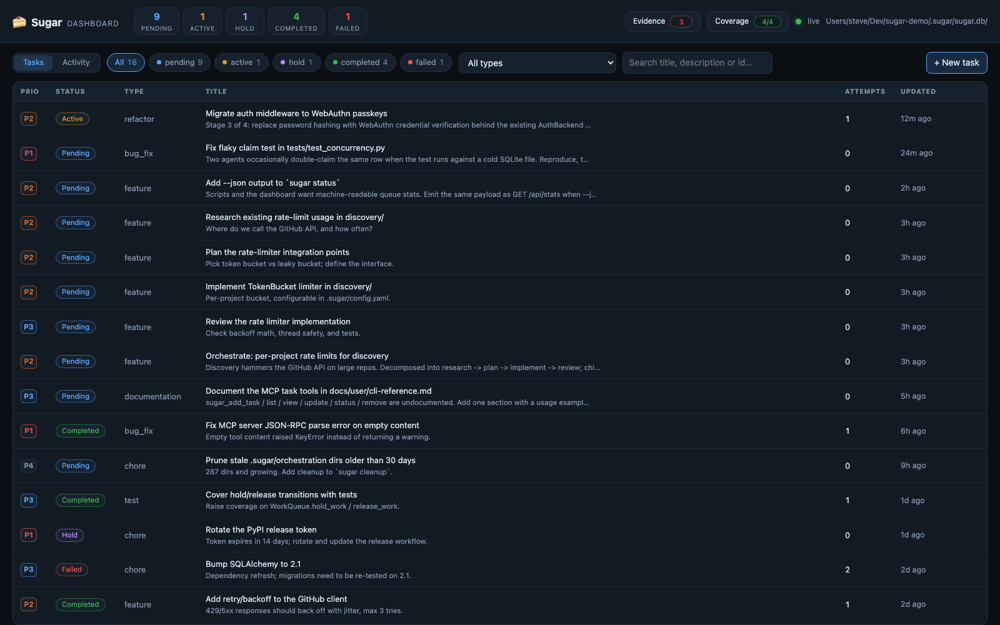
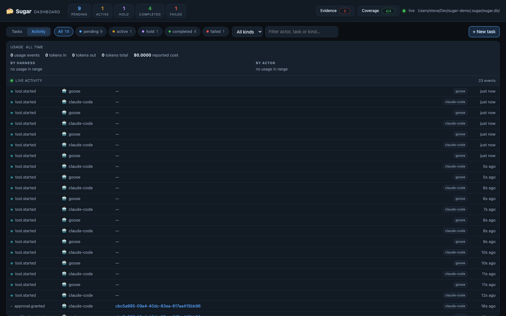
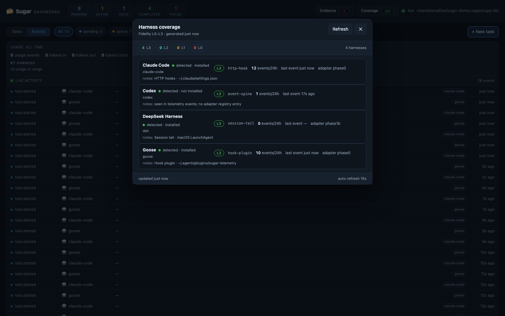
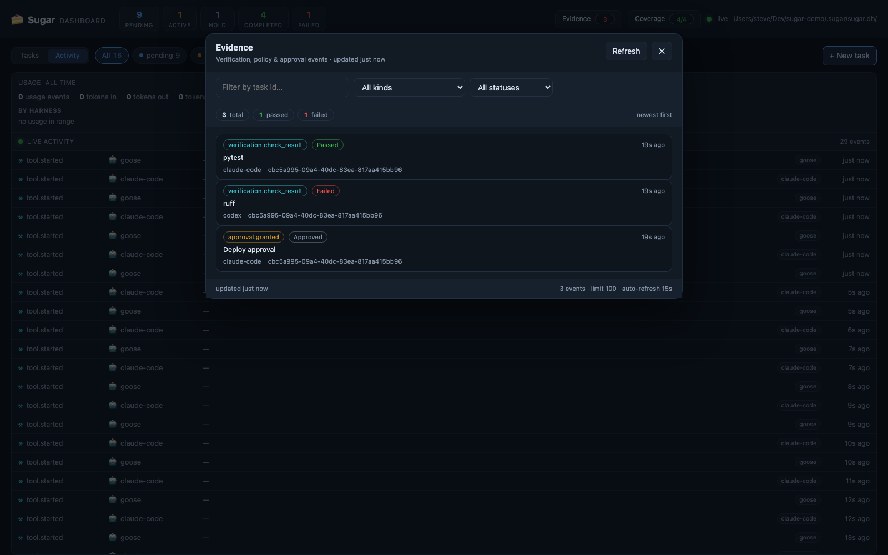

# Web Mission Control (macOS, Linux, Windows)

Sugar's primary UI is the **browser dashboard**. It runs anywhere the `sugar`
CLI runs — macOS, Linux and Windows — with no native app required. The macOS
SugarDash app is an optional extra client on the same API.

```bash
pipx install 'sugarai[all]'
sugar dashboard --open          # http://127.0.0.1:7331
```

The dashboard is served by the same local process as the board. It binds
loopback by default; for a team, expose it on your own network with scoped
tokens (see [Board Server](board-server.md)).

## What you get

| View | What it shows |
|---|---|
| **Tasks** | Queue, status/hold/failed counts, priority/type, search, task detail and history |
| **Activity** | Live event feed with usage/cost summary, per-task context, streaming updates |
| **Coverage** | Harness detection/installation, L0–L3 fidelity, transport, events/24h, last seen, notes |
| **Evidence** | Verification, policy and approval records with passed/failed/blocked summaries, task/kind/status filters |
| **Trends API** | `/api/trends` is available; the visual Trends view is currently in SugarDash |

### Tasks



### Activity — live, no refresh



### Coverage



### Evidence



## Near real-time, how it works

The dashboard is not polling a static board every few seconds. Events fan out
over **SSE** (`GET /api/events`):

```text
harness hook / OTLP / DSH tail / SDK
  → POST /api/hooks/<harness>, /v1/traces, /api/events
  → normalize + redact + dedupe
  → append to ~/.sugar/events.db
  → SSE `activity` event to every open dashboard
  → Activity feed inserts the row immediately; Tasks/coverage refresh in-place
```

Local numbers measured against a running board (15 hook posts, POST → visible in
`/api/activity`):

- **median ~2.8 ms**
- **p95 ~5 ms**
- max ~16 ms

That is ingest-to-visible on the local board. End-to-end latency also includes
the harness's hook overhead: HTTP hooks are effectively immediate; command hooks
add a process spawn (~50–400 ms); the DSH session tail polls every 2 s.

<video controls muted loop playsinline poster="images/web-activity.png" width="880">
  <source src="videos/web-live.mp4" type="video/mp4">
</video>

[Download the 13-second Activity clip](videos/web-live.mp4) · [animated GIF](images/web-live.gif)

Coverage and Evidence are snapshot panels rather than raw streams: they refresh
on open, on a filter change, and every 15 s while visible. The Activity feed is
the live stream.

## Web vs native app

| Capability | Browser | SugarDash (macOS) |
|---|---|---|
| Tasks, task detail | ✅ | ✅ |
| Activity feed | ✅ | ✅ |
| Coverage | ✅ | ✅ (after the parity update) |
| Evidence | ✅ | ✅ (after the parity update) |
| Live floor + streaming console | — | ✅ |
| Trends charts | API only | ✅ |
| Runs on Linux/Windows | ✅ | — |
| Remote/token-protected board | ✅ via browser cookie/token | loopback only today |

So Linux/Windows users get the full control-plane views (tasks, activity,
coverage, evidence); the macOS app remains the place for the animated Live floor,
console and Trends charts.

## Remote/team mode

```bash
# On the Linux/macOS box that owns the board
sugar dashboard --bind 0.0.0.0 --allow-remote --token-file ~/.sugar/board-tokens
```

Put TLS in front (Caddy/nginx), share scoped `read`/`write` tokens, and open the
dashboard in any browser. The browser exchanges a one-time token for a
`SameSite=Strict` cookie; API/SSE accept `Authorization: Bearer`. Nothing is
hosted by us. See [Board Server](board-server.md) for the threat model.

## Requirements and limits

- Python 3.11+ and a modern browser. No Node build step, no CDN dependency.
- The web UI talks to one board (Sugar queue or Hermes Kanban) through the frozen
  REST/SSE contract in [Local Dashboard API](local-dashboard.md).
- Native SugarDash-only views are listed above; they are not a reason to install
  the app unless you want the Live floor, console or Trends charts.
- Very large activity histories are paged by the feed; use filters or the API
  for bulk export.

## Related

- [Mission Control](mission-control.md) — the full control plane and native app.
- [Local Dashboard API](local-dashboard.md) — REST/SSE contract.
- [Board Server](board-server.md) — remote binding, tokens, TLS.
- [Telemetry Adapters](telemetry-adapters.md) — how harness events reach the board.
- [Evidence Ledger](evidence.md) — verification/policy/approval records.
